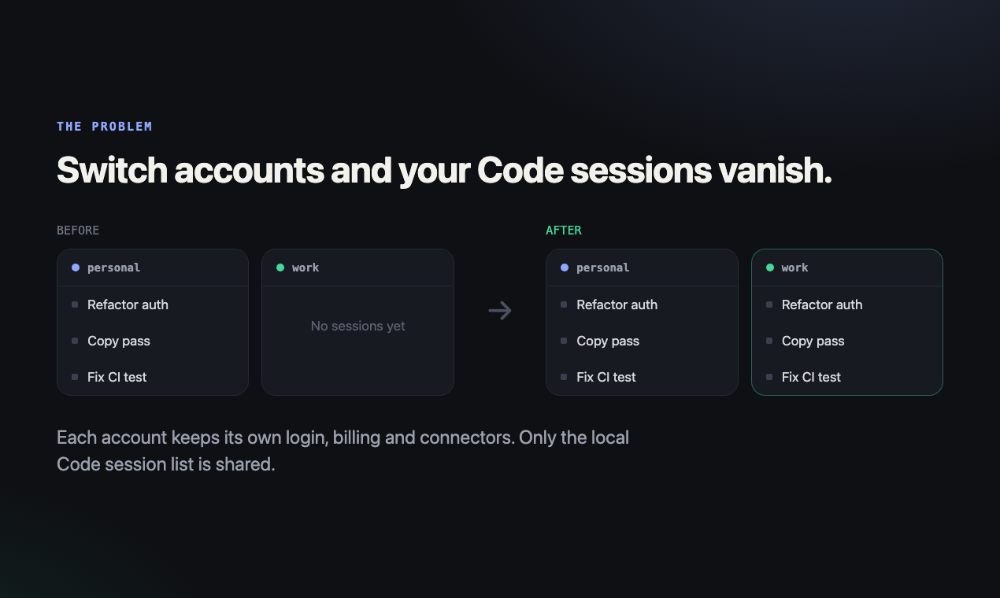
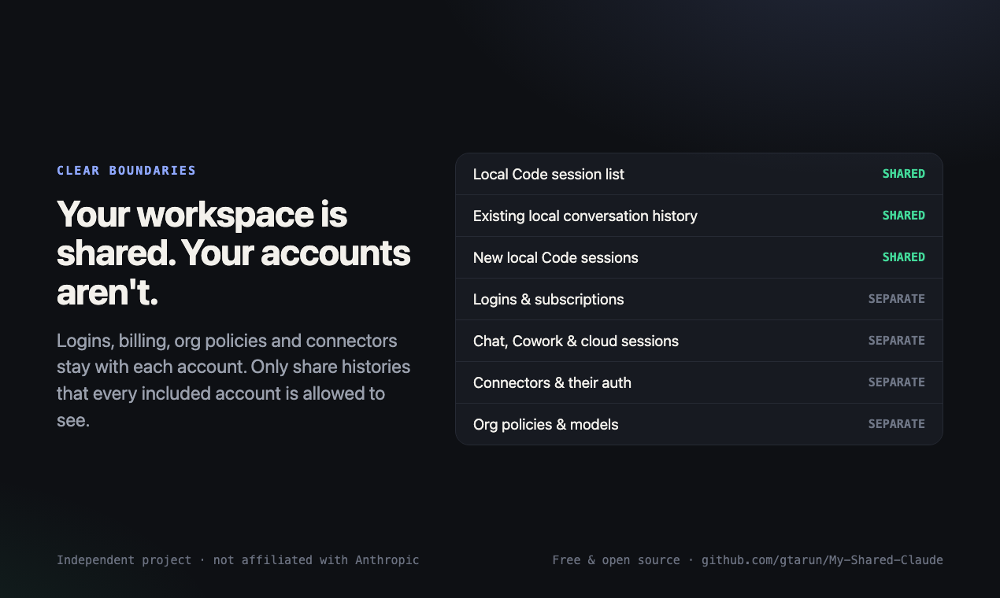
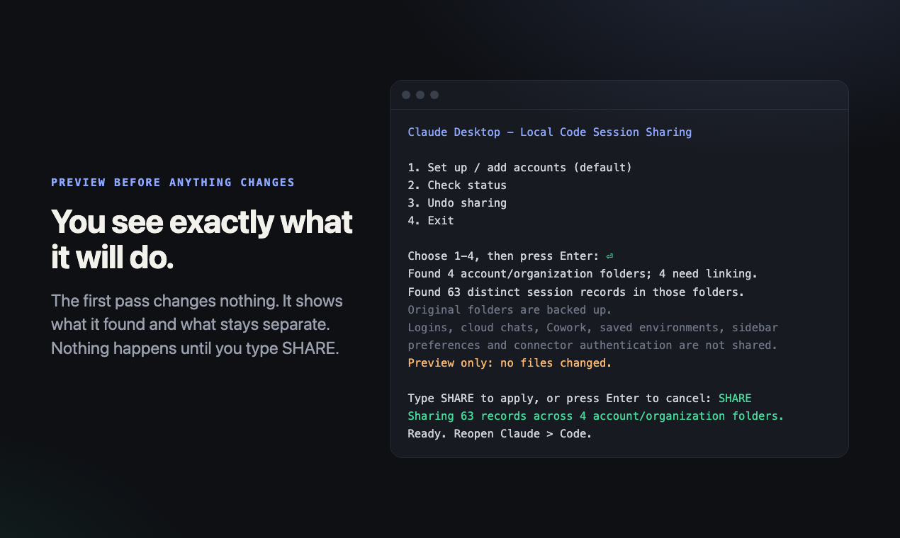

I use Claude Code inside Claude Desktop with two accounts on the same laptop: a personal one and a work one. For a while, one small thing annoyed me every day:

**every time I switched accounts, my entire Code sidebar changed.**

The session I'd been working in an hour earlier was simply gone until I switched back. Nothing was deleted. It just belonged to the other account.

So I dug into where Claude Desktop keeps those sessions, and wrote a small open-source helper, [My Shared Claude](https://github.com/gtarun/My-Shared-Claude), that gives all my accounts one shared local session list. This post covers what I found and how it works.

> Not affiliated with Anthropic. This relies on Claude Desktop's current on-disk layout, which could change in any update.



## Where the sessions live

Claude Desktop keeps a data folder per user:

| OS | Data folder |
|----|-------------|
| macOS | `~/Library/Application Support/Claude` |
| Windows | `%APPDATA%\Claude` (plus some Store-package variants) |
| Linux | `~/.config/Claude` |

Inside it, local Code sessions are stored like this:

```text
claude-code-sessions/
  <account-uuid>/
    <organization-uuid>/
      local_<session-uuid>.json
      local_<session-uuid>.json
      ...
```

Each account/organization pair gets its own folder of `local_*.json` session records. The Code sidebar only reads the folder that matches whoever is signed in. That's the whole reason sessions "disappear" when you switch.

One surprise: **a single email login can have several organization folders**, so you'll often find more folders than you have accounts.

## The approach: merge once, then link

I considered syncing copies back and forth, but that means watching files, resolving conflicts on every change, and running something in the background. Instead, the tool does a one-time merge and then lets the filesystem do the work:

1. **Find** every `claude-code-sessions/<account>/<org>/` folder.
2. **Merge** all `local_*.json` records into one shared store (`shared-code-sessions/`). If the same session ID appears in two folders, the most recently modified file wins.
3. **Back up** each original folder by moving it to a timestamped backup directory.
4. **Link** each original folder path to the shared store.

After that, every account reads and writes the same folder, so new sessions show up everywhere automatically. Nothing runs in the background.

```python
def create_directory_link(path, target):
    if sys.platform == 'win32':
        # A junction needs no Developer Mode or admin rights
        ...  # New-Item -ItemType Junction via PowerShell
    else:
        path.symlink_to(target, target_is_directory=True)
```

## Windows: junctions, not symlinks

On macOS and Linux a plain symlink is fine. On Windows, creating a symlink usually needs Developer Mode or admin rights, which I wanted to avoid for non-technical teammates. **Directory junctions** work for a normal user, so the tool creates those through PowerShell.

Two details mattered:

- Paths are passed as quoted literals inside an encoded PowerShell command, so a folder name with odd characters stays data and can't become part of the command.
- Removing a link has to remove *the link*, not the folder it points to. On Windows a junction is removed with `rmdir`. The tool refuses to remove anything that isn't actually a link.

## Not sharing what shouldn't be shared

Session records contain some fields that belong to the account that created them, such as Remote Control / bridge IDs and remote MCP server configuration. Carrying those into another account would be wrong, so imported copies have them stripped:

```python
def clean(record):
    result = dict(record)
    for key in list(result):
        if key.startswith(('remoteControl', 'bridge', 'steeredByRemote')) or key in {
            'remoteMcpServersConfig', ...
        }:
            result.pop(key, None)
    result['remoteControlAutoEligible'] = False
    return result
```

What it deliberately **doesn't** touch:

- logins and subscriptions
- ordinary chats, Cowork and cloud sessions
- connectors and their authentication
- org policies and available models
- sidebar preferences (folder grouping is per account)



One honest caveat: only combine histories you're comfortable having available under every included account. If one of them is a work org, think about that first.

## Safety rails

Since this moves folders that hold your conversation history, most of the code is about not making things worse:

- **Claude must be closed.** It checks for running Claude processes and stops if it finds any.
- **Preview first.** The default run is a dry run that reports what it found. Nothing changes until you type `SHARE`.
- **Validation before touching anything.** Every record must be a real file (not a symlink), parse as JSON, and have a `sessionId` that matches its filename and is a valid UUID. Anything unexpected stops the run before any folder is moved.
- **Journal plus backups.** Each change is recorded in a small JSON journal (written atomically, owner-only permissions), so `status` and `undo` know exactly what was done.
- **One-step undo.** Undo removes the links and restores the original folders from backup. New sessions created while sharing was on stay in the shared store, so nothing is lost.



## Making it usable for non-developers

Half the people I wanted to help don't use a terminal, so each OS gets a double-click launcher (`.command`, `.cmd`, `.sh`) that checks for Python 3.9+ and then shows a small menu:

```text
1. Set up / add accounts (default)
2. Check status
3. Undo sharing
4. Exit
```

There are no dependencies, nothing to `pip install`, and it never asks for admin rights or `sudo`.

## Testing on three OSes

The filesystem behavior is the risky part, and it differs per OS. GitHub Actions runs the test suite on **macOS, Windows and Ubuntu with Python 3.9 and 3.12**, covering setup, adding a new account later, and undo using real symlinks and junctions.

I've verified end-to-end history loading in Claude Desktop on macOS. On Windows and Linux, the automated filesystem tests pass, and I'd really like reports from real installs.

## Try it

- Repo (MIT): https://github.com/gtarun/My-Shared-Claude
- Direct download: https://github.com/gtarun/My-Shared-Claude/releases/latest/download/My-Shared-Claude-v1.0.zip

Quit Claude, double-click the launcher for your OS, check the preview, and type `SHARE`.

If you try it, I'd love to hear:
1. Does it work on your Windows or Linux setup?
2. Would you want to choose which accounts get linked, instead of all of them?
